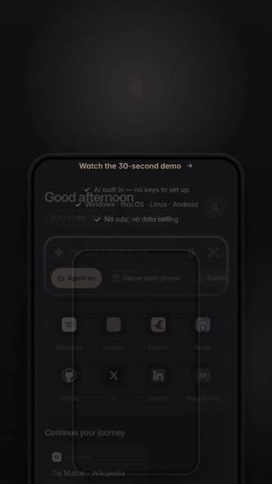
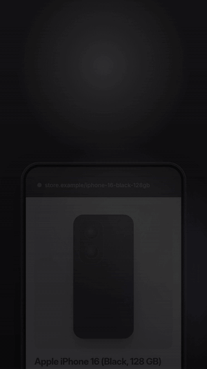

<div align="center">


# Cairn — the agentic browser

**Just say it. Cairn gets it done.** Ask in English, Hindi, Hinglish or any language. Cairn browses, compares prices across trusted stores, fills your cart and stops at payment so you approve it with your fingerprint.

[](https://github.com/jangidpranshu1989-create/cairn/releases/latest/download/Cairn-Android.apk)
[](https://jangidpranshu1989-create.github.io/cairn/download.html#desktop)

[Website](https://jangidpranshu1989-create.github.io/cairn/) · [Get it on Obtainium](https://apps.obtainium.imranr.dev/redirect?r=obtainium://add/https://github.com/jangidpranshu1989-create/cairn) · [Changelog](https://jangidpranshu1989-create.github.io/cairn/changelog.html) · [Latest release](https://github.com/jangidpranshu1989-create/cairn/releases/latest)

 &nbsp; 

Full 30-second demos (1080x1920): [Home and answers](https://github.com/jangidpranshu1989-create/cairn/releases/download/v3.0.0/Cairn-Demo-Home.mp4) · [Shopping and Circle to Ask](https://github.com/jangidpranshu1989-create/cairn/releases/download/v3.0.0/Cairn-Demo-Shopping.mp4)

</div>

## What's new in 3.4

- **Automatic updates** — Android downloads new versions in the background, verifies them and installs them when you're not using the app (silent on Android 12+ after the first update; Settings → About). Windows and Linux AppImage update on quit.
- **Chrome-speed loading** — instant Back/Forward, prerendered links and early connections while you type.
- **Passkeys like Chrome** — sites offer "Sign in with a passkey" and your Cairn passkey shows above the keyboard.
- **Download manager** — parallel connections for big files, safe resume and automatic retry when the network returns.
- **Hardware-signed payment approvals** — on Android 11+ approvals are signed by a key in the phone's secure hardware.
- **Safer Cairn Cloud** — ticket-only live connection, capped transfers and a sign-in page that doesn't reveal which emails exist.

Earlier highlights (3.0): bento Home with Search / Agent switch and voice, one-minute setup, exact-match shopping from trusted stores, checkout that stops for your fingerprint before any payment, Circle to Ask, rich answers with citations. Free and made in India, no API key needed.

## Inside this repo

This repository contains the complete product:

| Folder | What it is | Stack |
|---|---|---|
| `desktop/` | The Cairn browser for Windows, macOS and Linux | Electron 45 (Chromium), vanilla JS UI |
| `android/` | Cairn for Android — a full mobile browser with the same agent, Shield, passwords, downloads, read-aloud and fingerprint payment approvals | Kotlin, Jetpack Compose, AndroidX WebKit, OkHttp, BiometricPrompt |
| `server/` | Cairn Cloud — accounts, passkeys, pairing, approvals, transfers, AI proxy | Node 22, Express, SQLite (better-sqlite3), WebSocket |
| `website/` | Launch website (home, features, download, pricing, security, about, contact, changelog, privacy, terms, 404) | Static HTML/CSS/JS, generated by `tools/build_site.py` |
| `.github/workflows/` | CI: server smoke test, desktop installers on 3 OSes, Android APK | GitHub Actions |

## Architecture

```
 ┌────────────────────── Desktop (Electron) ──────────────────────┐
 │ Browser UI (tabs, omnibox, assistant panel, settings pages)    │
 │ Agent loop ── 23 tools: web_search, compare_prices, open_url,  │
 │   click, type, select_option, scroll, read_article, read_aloud,│
 │   summarize_page, make_mindmap, save_pdf, screenshot,          │
 │   send_to_phone, request_approval, ask_user, …                 │
 │ LLM client ── Cairn Cloud AI proxy (no keys on the device)     │
 │ Local vault: passwords + passkeys encrypted via OS keychain    │
 └───────────────▲────────────────────────────────────────────────┘
                 │ HTTPS + WSS
                 ▼
 ┌──────── Cairn Cloud (server/) ────────┐
 │ AI proxy: Groq → NVIDIA → Gemini →      │
 │ OpenRouter → Kilo / OVH / Pollinations  │
 │ auth (bcrypt, JWT + rotating refresh,   │
 │ CAPTCHA, lockout, passkeys/WebAuthn)    │
 │ device pairing (QR), approvals (3 min), │
 │ transfers (≤100 MB, 24 h), sync blobs   │
 └───────────────▲─────────────────────────┘
                 │ WSS (foreground service)
 ┌───────────────┴── Cairn for Android ──┐
 │ Full browser (WebView/Chromium): tabs,  │
 │ private tabs, Shield, passwords, reader │
 │ Agent: shopping, read-aloud, mind maps  │
 │ QR pairing · biometric approvals        │
 │ (FLAG_SECURE) · files → Download/Cairn│
 └─────────────────────────────────────────┘
```

## Free deploy (₹0)

| Piece | Where | How |
|---|---|---|
| Cairn Cloud (server) | Render (`render.yaml`) or Koyeb | See [`deploy/koyeb.md`](deploy/koyeb.md). Add an UptimeRobot 5-minute ping on `/api/health` for Render. |
| Database | Turso free tier | Set `TURSO_DATABASE_URL` + `TURSO_AUTH_TOKEN`; otherwise local SQLite (wiped on free-host restarts). |
| AI keys | Groq (free), Gemini (free) | `GROQ_API_KEY` is needed for camera/photo understanding; `GEMINI_API_KEY` is a vision fallback. |
| Website | GitHub Pages / Vercel / Cloudflare Pages | `pages.yml` deploys `website/` on every push to `main`. |
| APK | GitHub Releases | Tag `vX.Y.Z`; CI builds a signed `Cairn-Android.apk`. Obtainium/IzzyOnDroid read the release. |

Build the APK against your own server with `./gradlew assembleRelease -PcairnServer=https://your-server`.

## Quick start (local)

Requirements: Node 20+ (CI uses 22), (for Android) JDK 17 + Android SDK 35.

```bash
# 1. Server
cd server
cp .env.example .env          # set JWT_SECRET; optionally GROQ_API_KEY / NVIDIA_API_KEY
npm ci
node src/index.js             # http://localhost:8787

# 2. Desktop browser
cd ../desktop
npm ci
npm start                     # dev build talks to http://localhost:8787
```

In the browser open **Settings → AI** and paste a free key from [console.groq.com/keys](https://console.groq.com/keys) or [build.nvidia.com](https://build.nvidia.com). Keys are stored encrypted with the OS keychain. Alternatively choose **Cairn Cloud** mode to use the server's keys (fair-use quota per account).

### Docker (server)

```bash
cd server
docker build -t cairn-server .
docker run -d -p 8787:8787 -v cairn-data:/data --env-file .env cairn-server
```

Put it behind TLS (Caddy / nginx / a managed load balancer) at the hostname in `PUBLIC_URL`. Passkeys need `RP_ID` to match your domain and `RP_ORIGINS` to list the exact origins.

## Building installers

```bash
cd desktop
npm run dist:win     # dist/Cairn-Setup-x64.exe   (NSIS)
npm run dist:mac     # dist/Cairn-mac-arm64.dmg / Cairn-mac-x64.dmg (+ zip)
npm run dist:linux   # dist/Cairn-linux-x64.AppImage / .deb
```

- Packaged builds default to `https://cairn-cloud.onrender.com`; override with `CAIRN_SERVER=https://your-host` or in Settings → Phone & sync → Cairn Cloud URL.
- **Code signing:** set `CSC_LINK` / `CSC_KEY_PASSWORD` (Windows/macOS) and, for macOS notarisation, `APPLE_ID`, `APPLE_APP_SPECIFIC_PASSWORD`, `APPLE_TEAM_ID`. Unsigned builds work but show SmartScreen / Gatekeeper warnings.
- **Releases:** pushing a tag `v*` runs CI and publishes installers to GitHub Releases (`jangidpranshu1989-create/cairn`; for a fork, change `build.publish` in `desktop/package.json` and the download links in `tools/build_site.py` to your repo).

### Android

```bash
cd android
export JAVA_HOME=/path/to/jdk17 ANDROID_HOME=/path/to/android-sdk
./gradlew assembleRelease     # app/build/outputs/apk/release/app-release.apk
```

UI screenshot tests (JVM, no emulator needed) use Paparazzi and are opt-in:

```bash
./gradlew -Pshots :app:recordPaparazziDebug   # PNGs in app/src/test/snapshots/images/
```

For a Play-Store-ready signature create `android/keystore.properties`:

```
storeFile=/abs/path/cairn-release.jks
storePassword=…
keyAlias=cairn
keyPassword=…
```

Without it the release APK is signed with the debug key (fine for testing, not for distribution).

## Website

```bash
python3 tools/build_site.py          # renders website/*.html from tools/site_pages/*
cd website && python3 -m http.server 8080
```

Page bodies live in `tools/site_pages/`; the shared header/footer, icons, version and release URL are in `tools/build_site.py`. The contact form and Pro waitlist post to `https://cairn-cloud.onrender.com/api/public/contact` (stored in the `messages` table, honeypot + rate limit) and fall back to `mailto:` if the API is unreachable.

## Configuration reference

All server settings are in `server/.env.example`. Desktop settings are stored per user in the Electron `userData` folder (`settings.json`, `history.json`, encrypted `vault.json`).

## Security & privacy summary

- Payments always require explicit approval (phone biometrics or an in-browser click). The agent stops at the payment step.
- Password, card-number, CVV and PIN field values are masked before page snapshots are sent to the model.
- Logins, OTPs and CAPTCHAs are detected and handed back to the user.
- Server: Helmet, strict CORS, zod validation, rate limits, CAPTCHA after failed logins, 15-minute lockout after 10 failures, retention jobs (approvals 30 days, messages/audit 12 months).
- Users can delete their account from `cairn://account`.

## Known limitations (honest list)

- **Store blocking:** Amazon and some retailers block datacenter/cloud IPs and headless traffic. On a normal home connection the comparison works; from servers/VPNs some stores may return no results. Store markup changes over time — the extractors in `desktop/src/main/agent/shopping.js` will need maintenance.
- **Payments:** Cairn never enters UPI PINs, card CVVs or bank OTPs. The phone approval authorises the agent to proceed; the final bank/UPI step is done by the user.
- **Read aloud in Hindi** uses the operating system's voices (Windows/macOS include Hindi; many Linux distros don't). The cloud TTS fallback (Groq `canopylabs/orpheus-v1-english`) is English only.
- **Passkeys inside Electron** rely on the OS authenticator: they work best on Windows (Windows Hello) and macOS; most Linux desktops have no platform authenticator, so use email + password there.
- **Android background delivery** uses a foreground WebSocket service (`remoteMessaging|dataSync` foreground-service types). For very large user bases switch to Firebase Cloud Messaging for wake-ups.
- **No API keys are bundled.** Apps never hold AI keys; set `GROQ_API_KEY` / `NVIDIA_API_KEY` (optional) on the server. Without them Cairn Cloud uses the keyless Kilo, OVHcloud and Pollinations gateways.
- **Domain:** `cairn.app` belongs to someone else. The website lives at https://jangidpranshu1989-create.github.io/cairn (GitHub Pages, `.github/workflows/pages.yml`; `vercel.json` also works). Buy your own domain (e.g. a `.in`) and pass `-PcairnSite=https://your.domain` to the Android build when you do.
- Assumptions to change before launch: Pro price ₹199/month, contact goes to GitHub issues until you have a domain email, governing law (Jaipur, India) in the Terms. Have a lawyer review `privacy.html` and `terms.html`.

## License

Cairn is open source under the [Apache License 2.0](LICENSE). Copyright © 2026 Cairn contributors. Third-party components (Electron/Chromium, AndroidX, etc.) are under their own licenses. The Cairn name and logo are not covered by the license.
